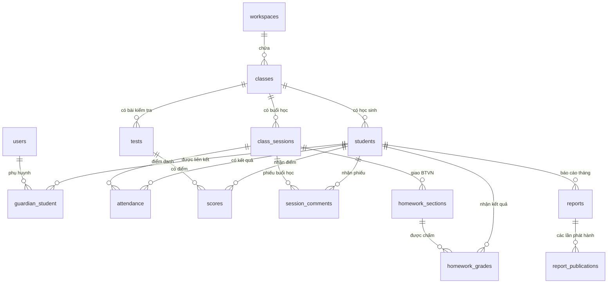
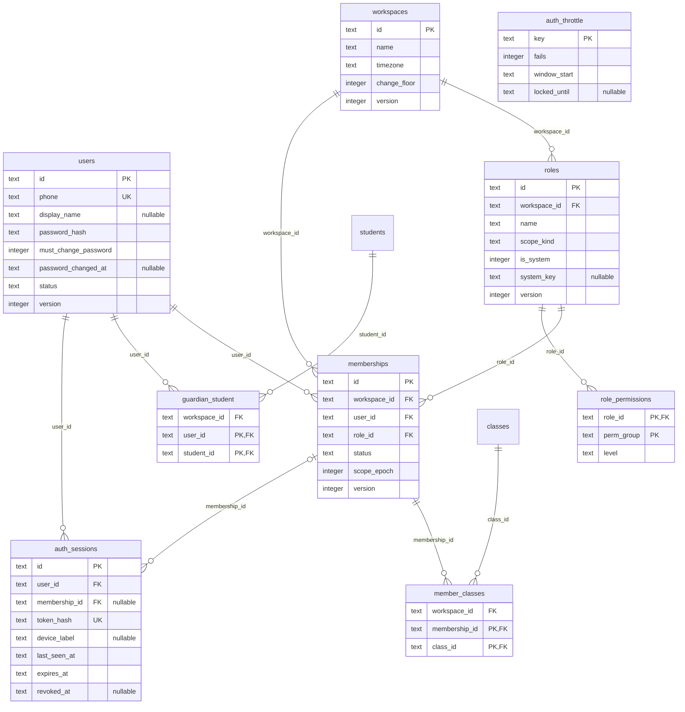
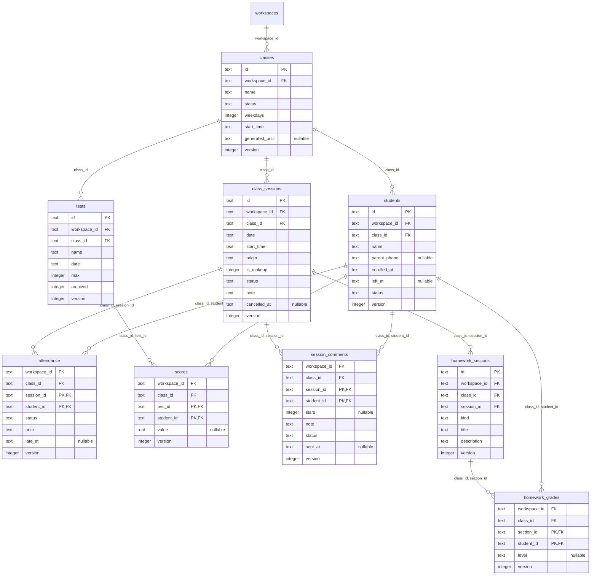
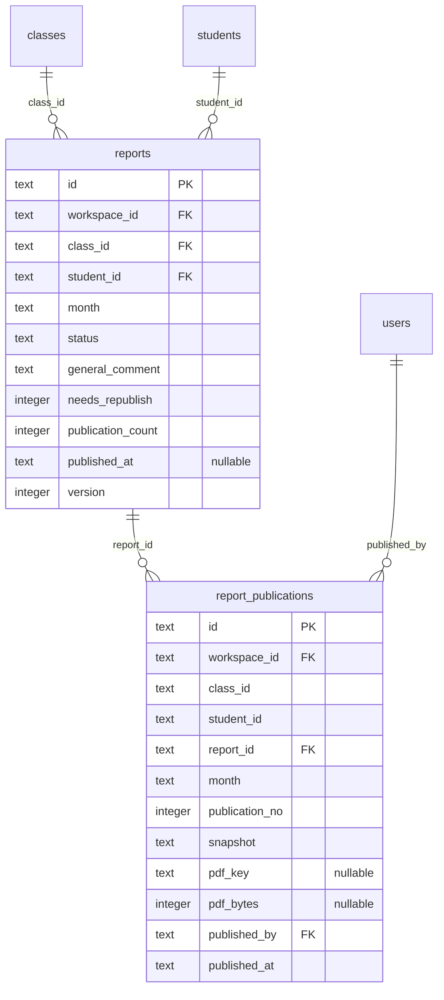
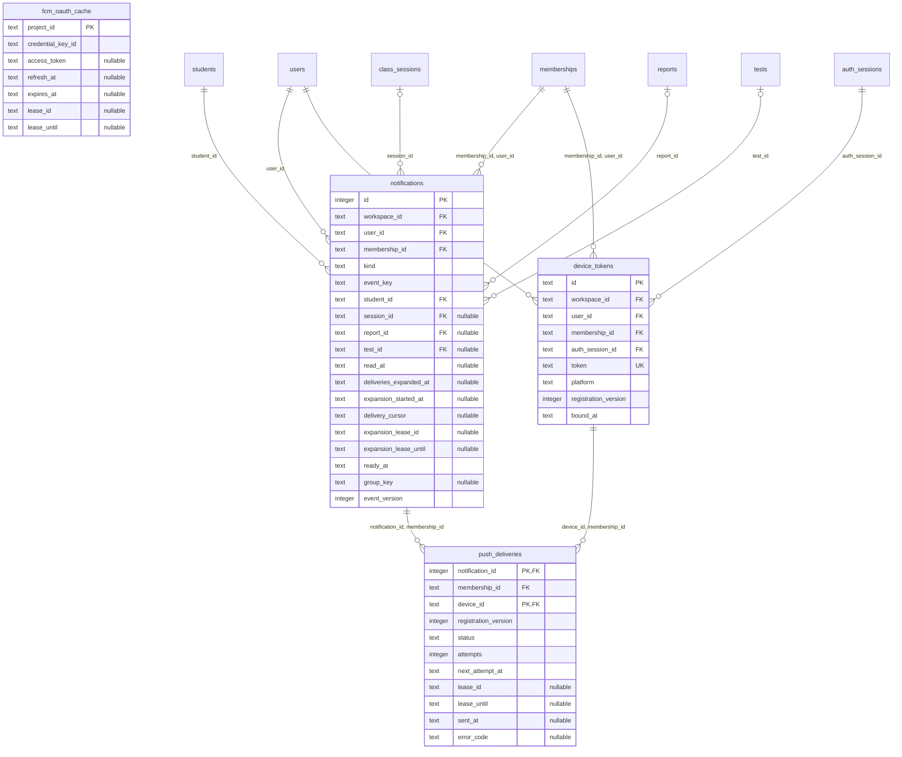

# ERD — MVP hiện tại

Cập nhật: 2026-10-24. Phản ánh schema D1 trong `worker/migrations/0001_schema.sql` và các migration tiếp theo; phạm vi nghiệp vụ đối chiếu `docs/spec.md`, mục 8. Không phải mô hình thiết kế cho các tính năng làm sau.

**Cách đọc:** `||` = đúng một; `o|` = không hoặc một; `o{` = không hoặc nhiều. PK = khóa chính, FK = khóa ngoại, UK = khóa duy nhất một cột. PK nhiều cột là khóa ghép. `nullable` = có thể NULL. Nét liền biểu diễn FK trong schema; nét đứt biểu diễn liên kết logic không có FK.

Các sơ đồ lược bớt timestamp chung và cột người tạo/sửa; chỉ vẽ quan hệ chính để dễ đọc. Bảng xuất hiện lại ở sơ đồ khác là cùng một bảng. Khóa ngoại ghép chứa `workspace_id`/`class_id` được rút gọn thành một đường quan hệ; xem migration để biết đầy đủ ràng buộc. Không phải cột có hậu tố `_id` nào cũng có FK.

## Tổng quan nghiệp vụ

## 1. Tài khoản, workspace và phân quyền

## 2. Lớp, buổi học, điểm danh, điểm và BTVN

## 3. Báo cáo và phiên bản phát hành

## 4. Thông báo và push

## 5. Lịch sử và đồng bộ

```mermaid
erDiagram
    attendance_history {
        integer id PK
        text workspace_id
        text session_id
        text student_id
        text old_status "nullable"
        text new_status
        text old_note "nullable"
        text new_note "nullable"
        text old_late_at "nullable"
        text new_late_at "nullable"
        integer old_version
        integer new_version
        text changed_by "nullable"
        text changed_at
    }
    score_history {
        integer id PK
        text workspace_id
        text test_id
        text student_id
        real old_value "nullable"
        real new_value "nullable"
        integer old_version
        integer new_version
        text changed_by "nullable"
        text changed_at
    }
    applied_commands {
        text command_id PK
        text workspace_id
        text membership_id
        text type
        text status
        text result
        text applied_at
    }
    sync_conflicts {
        text id PK
        text workspace_id FK
        text class_id FK
        text entity
        text k1
        text k2
        text server_value
        integer server_version
        text client_value
        integer client_base_version
        text command_id
        text membership_id
        text resolved_at "nullable"
        text resolved_by FK "nullable"
        text resolution "nullable"
        integer version
    }
    change_log {
        integer seq PK
        text workspace_id
        text entity
        text k1
        text k2
        text op
        text class_id
        text student_id "nullable"
    }
    classes ||--o{ sync_conflicts : "class_id"
    users o|--o{ sync_conflicts : "resolved_by"
    attendance ||..o{ attendance_history : "lịch sử ô điểm danh"
    scores ||..o{ score_history : "lịch sử ô điểm"
    memberships ||..o{ applied_commands : "membership_id logic"
    memberships ||..o{ sync_conflicts : "membership_id logic"
```

## Các điểm cần lưu ý

- **29 bảng ứng dụng** trong schema hiện tại, chưa tính `sqlite_sequence` nội bộ SQLite.
- `students` thuộc một lớp qua `class_id`; chưa có bảng ghi danh nhiều lớp riêng. Ngày vào/nghỉ nằm ở `enrolled_at`, `left_at`.
- Một user có nhiều membership; mỗi membership thuộc một workspace và một role. `member_classes` là phạm vi lớp được gán, không phải phân công giáo viên chính/trợ giảng.
- `guardian_student` nối phụ huynh với học sinh theo user, không theo membership. Một phụ huynh có thể liên kết nhiều con.
- Điểm danh, điểm, phiếu buổi học và chấm BTVN dùng khóa ghép hai cột. Các FK ghép giúp giữ dữ liệu cùng workspace/lớp.
- `tests.max` là điểm tối đa từng bài. `scores.value` có thể NULL; không có dòng hoặc giá trị NULL biểu diễn chưa có điểm. Không có cột điểm trung bình hay vắng thi.
- `homework_sections` duy nhất theo `(session_id, kind)`, tối đa bốn loại. Buổi chấm là buổi chưa hủy kế tiếp, suy ra khi đọc; không có FK lưu buổi chấm. Kết quả chấm được phụ huynh xem theo trạng thái gửi phiếu.
- `reports` duy nhất theo `(student_id, month)`; `report_publications` duy nhất theo `(report_id, publication_no)`, lưu snapshot mỗi lần phát hành. Schema còn có `pdf_key`, `pdf_bytes`; sự tồn tại của cột không chứng minh tệp PDF được lưu trên máy chủ.
- `attendance_history` và `score_history` do trigger ghi khi sửa. Các cột định danh trong hai bảng này không khai báo FK. `applied_commands` chống áp dụng lặp; `sync_conflicts` giữ hai giá trị xung đột; `change_log` phục vụ kéo thay đổi. `k1`, `k2` là khóa theo loại entity, không có FK tĩnh.
- `auth_throttle` và `fcm_oauth_cache` là bảng kỹ thuật độc lập, không có FK.

## Khác biệt với tài liệu thiết kế

ERD này ghi nhận hiện trạng, không thay đổi spec hoặc kiến trúc:

- Schema có `users.password_hash`, `auth_sessions`, `auth_throttle`; chưa có bảng OTP hoặc `invites` được mô tả trong tài liệu.
- Schema push hiện tại dùng `device_tokens`, `push_deliveries`, `fcm_oauth_cache`, khác hướng Web Push/VAPID trong `docs/architecture.md`.
- Chưa có bảng bài giảng/tệp R2, học phí, lương hoặc phân công/dạy thay. Những phần này không được thêm vào ERD MVP.

## Kiểm chứng

Đã áp dụng tuần tự cả ba migration vào SQLite tạm trong bộ nhớ, đọc lại `PRAGMA table_info` và `PRAGMA foreign_key_list` để đối chiếu bảng, cột, PK và các đường FK. Toàn bộ 29 bảng ứng dụng được bao phủ trong năm sơ đồ chi tiết. Đây là kiểm chứng schema trong repo, không phải kiểm tra database production.
